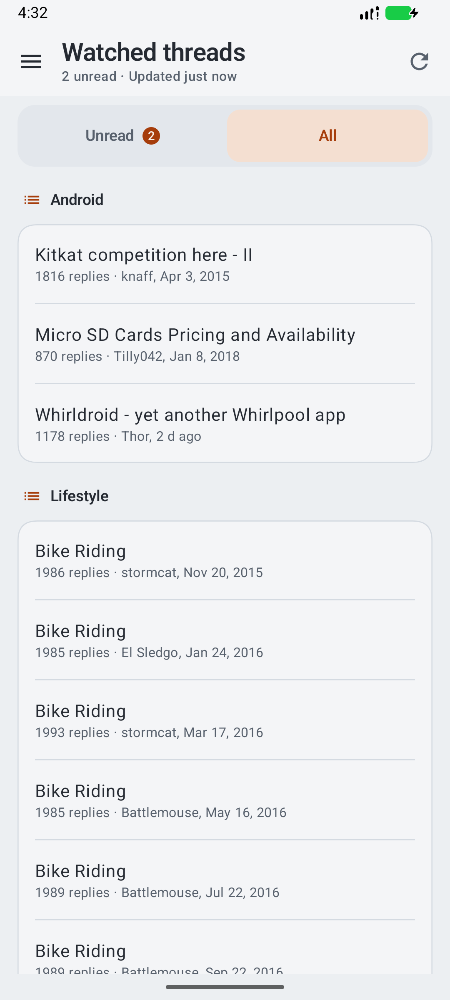
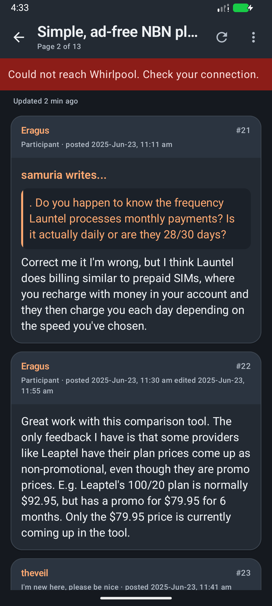
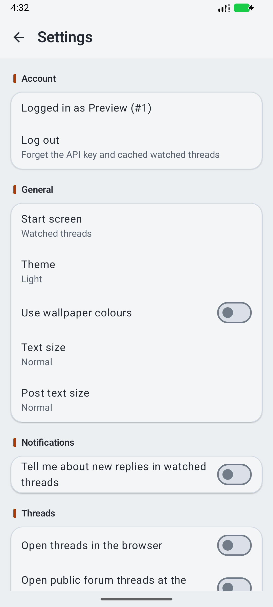

# Whirl

An Android client for the [Whirlpool](https://forums.whirlpool.net.au) forums: a modern Kotlin/Compose
rewrite with the features of the abandoned Whirldroid. Not affiliated with Whirlpool or with Whirldroid.

**Status:** early development, nothing usable yet. See [PLAN.md](PLAN.md) and [HANDOFF.md](HANDOFF.md).

## design

  
  
  

## Building

Requires JDK 17+ and the Android SDK (compile SDK 37). `./gradlew test assembleDebug`.
Parser tests run against real captured pages in `fixtures/`; no test touches the network.

## Releases

Signed APKs are published only by the tag-driven GitHub Actions workflow (`.github/workflows/release.yml`),
so every release is built from the public source at that tag. Each release lists the APK's SHA-256.

## Licence

MIT, see [LICENSE](LICENSE).
